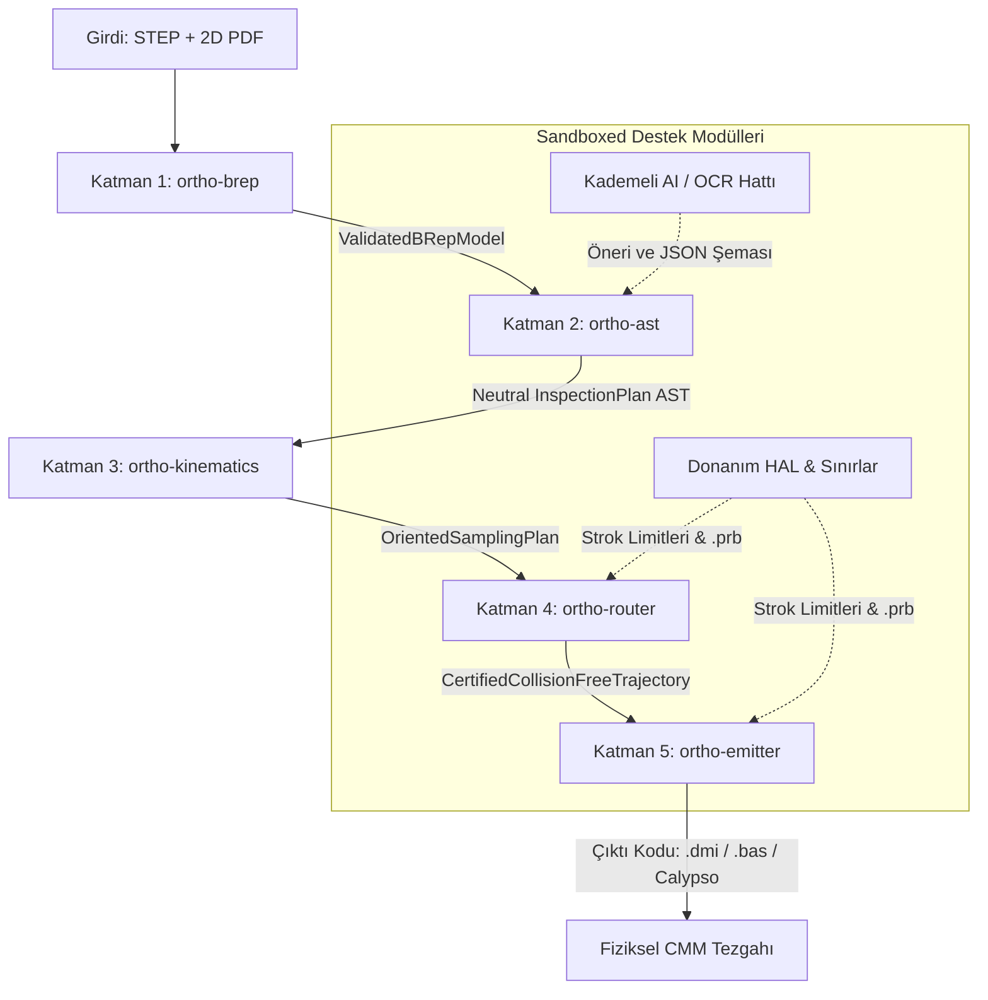

# Nuper Ortho — Sistem Mimarisi ve Tasarım Kalıpları (System Patterns)

## 1. 5 Katmanlı Derleyici Boru Hattı (Compiler Architecture)

Nuper Ortho, basit bir görselleştirici veya script aracı değil; CAD geometrisini ve tolerans girdilerini makine seviyesinde CMM koduna derleyen katı bir **Endüstriyel Derleyicidir**.



---

## 2. Katmanlar Arası Veri Sözleşmeleri ve Sorumluluk Matrisi

| Katman | Rust Sandığı (Crate) | Girdi Sözleşmesi | Çıktı Sözleşmesi | Temel Mimari Sorumluluk |
|---|---|---|---|---|
| **Katman 1** | `ortho-brep` | Ham STEP Dosya Yolu | `ValidatedBRepModel` | OpenCASCADE C++ FFI (`cxx`), analitik yüzey sınıflandırması (`Plane`, `Cylinder`, `Cone`, `BSpline`), dışa bakan birim normaller, sınır telleri ve et kalınlığı analizi ($<2.5\text{ mm}$). |
| **Katman 2** | `ortho-ast` | `ValidatedBRepModel` + Toleranslar | `InspectionPlan` (IR) | Donanım-bağımsız Nötr Teftiş AST'si (IR). ISO 1101 / ASME Y14.5 3-2-1 Datum zinciri, 6-DoF rank denetimi, kademeli cep ağacı, vida dişi tespiti ve baypas bayrakları. |
| **Katman 3** | `ortho-kinematics` | `InspectionPlan` | `OrientedSamplingPlan` | İleri kinematik prob montaj ağacı, Renishaw PH10 720 diskret açı LUT optimizasyonu ($\theta \to \min$), MH20i K-means kümelemesi, Gauss ve Chebyshev temas noktası örnekleyicileri. |
| **Katman 4** | `ortho-router` | `OrientedSamplingPlan` + Keep-Out | `CertifiedTrajectory` | $+50\text{ mm}$ Emniyet Kutusu (Clearance Box), $5\text{ mm}$ normal geri çekilme, pabuç yasaklı alanları, 2-Opt TSP rota optimizasyonu, BVH geniş fazı ve `parry3d` GJK/EPA dar faz çarpışma fiziği. |
| **Katman 5** | `ortho-emitter` | `CertifiedTrajectory` + HAL Profili | Makine Kodu (`.dmi`, `.bas`) | Bildirimsel Tera/Jinja şablonlama motoru. `MODE/MAN` operatör kaba sıfırlaması, `TEMPR/PART` termal kompanzasyon, Z-First güvenli park el sıkışması, yerel magazin makroları ve SHA-256 dijital imzası. |

---

## 3. Temel Mimari Prensipler ve Sistem Değişmezleri (Invariants)

### A. Tip Seviyesinde Emniyet (Typestate Pattern)
Rust derleyicisi seviyesinde doğrulanmamış hiçbir hareket yolunun kod derleyicisine (`ortho-emitter`) geçmesine izin verilmez:
```rust
// Ham, henüz çarpışma kontrolünden geçmemiş hareket yolu
pub struct UncheckedTrajectory { /* ... */ }

// Yalnızca ortho-router tarafından onaylanmış emniyetli yol tipi
pub struct CertifiedCollisionFreeTrajectory {
    trajectory: UncheckedTrajectory,
    verification_hash: [u8; 32],
}

impl Emitter {
    // Derleyici kuralı: UncheckedTrajectory verilirse derleme hatası verir
    pub fn emit_pcdmis(&self, plan: &CertifiedCollisionFreeTrajectory) -> Result<String, EmissionError>;
}
```

### B. C++ FFI Sınır İzolasyonu (`cxx`)
OpenCASCADE (OCCT) kütüphanesi kendi referans sayımını (`Handle(Standard_Transient)`) işletir. Bellek sızıntısı veya geçersiz işaretçi çökmesini önlemek için:
- C++ nesneleri wrapper katmanında oluşturulur, verisi çıkarılır ve bellekten silinir.
- Rust tarafına yalnızca saf veri taşıyan düz yapılar (POD struct'lar, `[f64; 3]` dizileri ve güvenli enum'lar) geçirilir.
- Sıfır ham işaretçi (raw pointer) sızıntısı güvence altına alınır.

### C. Süpürülmüş Hacim Kapsül Modeli ve GJK/EPA Çarpışma Fiziği
Prob bir noktadan diğerine intikal ederken 3 boyutlu bir kapsül hacmi tarar:
- **Yakut Bilye:** $R_{\text{ball}}$ yarıçapında süpürülen küre.
- **Şaft ve Modül:** $R_{\text{stem}}$ ($1.5\text{ mm}$) ve $R_{\text{holder}}$ ($12.5\text{ mm}$) silindirik kapsülleri.
- **`parry3d` Dar Fazı:** Minkowski farkı $A \ominus B$ üzerinden GJK algoritmasıyla temas testi yapılır; temas varsa EPA algoritmasıyla dalma derinliği (penetration depth) hesaplanarak `Lift-and-Hop` rotası devreye sokulur.

### D. Sandboxed Yerel AI ve 5 Aşamalı Gardiyan
Yapay zekâya asla tezgaha doğrudan kod yazma yetkisi verilmez:
1. **GBNF Gramer Kısıtı:** `llama.cpp` çıktısı önceden belirlenmiş katı JSON şemasına zorlanır.
2. **B-Rep Zemin Gerçekliği (Ground-Truth Check):** AI bir delik okuduğunda STEP B-Rep sorgulanır; delik modelde yoksa halüsinasyon olarak anında silinir.
3. **Kinematik Aralık Doğrulaması:** $A135^\circ$ gibi imkansız açılar doğrudan reddedilir.
4. **Güven Skoru Eşiği:** Güven skoru $\%70$'in altındaysa operatöre sorulur.
5. **Sanal CMM Kuru Çalıştırma:** Tek bir mikronluk sürtünme tespit edilirse derleme butonu kilitlenir.

### E. Yerel Prob Magazini (MCR20) Makro Kuralı
Nuper Ortho, magazin yuvalarına **asla ham $(X, Y, Z)$ fiziksel koordinat basmaz**. Yalnızca tezgahın mastarlanmış yerel makrosunu çağırır (`LOADPROBE/TIP_NAME`). Fiziksel yuva yaklaşma rotası makinenin kendi firmware'ine delege edilir.

### F. Z-First Mutlak İntikal Protokolü (Safe Park Handshake)
Başlangıç ve bitiş hareketlerinde çapraz iniş kazalarını önlemek için:
1. İlk hareket: Bulunulan noktadan bağımsız olarak $Z$ ekseninde makine tavan emniyet düzlemine çıkış.
2. İkinci hareket: Parça merkezine yatay ($X/Y$) güvenli intikal.
3. Üçüncü hareket: Parçanın $+50\text{ mm}$ Clearance Box kutusuna dikey ($Z$) iniş.

### H. Evidence-First Drawing Ingestion ve Sıfır Sentetik Veri Değişmezi (No-Fabrication Invariant)
Teknik resim ve PDF okuma hattında kaynağı/evidence'ı olmayan hiçbir nominal, tolerans, datum veya GD&T üretilemez:
1. **Çıkarım Ölçüm Değildir:** PDF parser katmanı `measured`, `deviation` ve `status: PASS` üretemez. Henüz CMM tarafından fiziksel temasla ölçülmemiş tüm karakteristikler `status: UNMEASURED`, `measured: ""` ve `deviation: ""` olarak işaretlenir.
2. **Uydurma Değer Yasağı:** Çizimde bulunmayan datumlar için `["A", "B", "C"]` veya varsayılan pürüzlülük / tolerans uydurulamaz; bulunamayan veri boş (`[]` veya `""`) kalır.
3. **Dosya Adı İzolasyonu:** Dosya adındaki kelimelere (örn. "gobek", "3051") göre sabit metrik setleri veya yapay dallanmalar yapılamaz (Y4).
4. **Doğrulama Yaşam Döngüsü (Verification Lifecycle):** Karakteristikler `RAW` $\to$ `PARSED` $\to$ `DUAL_VERIFIED` $\to$ `CAD_VERIFIED` $\to$ `HUMAN_VERIFIED` açık durum makinesiyle izlenir; şüpheli durumlar `NEEDS_REVIEW` ve `CONFLICT` olarak işaretlenir.
5. **Menşe İzlenebilirliği (Provenance):** Her çıkarılan öğe sayfa numarası, sınırlayıcı kutu (`bbox`), çıkarma yöntemi (`PDF_VECTOR`, `OCR`) ve ayrıştırıcı sürüm bilgisini taşır.

---

## 4. Geliştirme Altyapısı ve Kodlama Desenleri (Dev Infrastructure Patterns)

Detaylar için bakınız: [developmentInfrastructureRules.md](file:///d:/Projects/nuper-project/nuper_ortho/memory-bank/developmentInfrastructureRules.md)

1. **Tek Doğruluk Kaynağı ve Otomatik Codegen:** Şemalar (`schemas/*.json`) merkezidir; TypeScript (`ipc.d.ts`), Python (`models/`) ve Rust tipleri `npm run codegen` ile üretilir. El ile tip senkronizasyonu yasaktır.
2. **WebGL Kaynak Yaşam Döngüsü (`SceneCleaner`):** Üçgen ağlar, geometriler ve materyaller sahneden çıkarılırken `.dispose()` çağrısı zorunludur. VRAM ve WebGL context sızıntıları izole edilir.
3. **16 ms Kuralı ve Web Worker İzolasyonu:** Earclip, Jacobi PCA gibi ağır algoritmalar `ui/src/workers/` içinde koşturulur; UI ana iş parçacığı asla 60 FPS altına düşürülmez.
4. **Sınır Katmanı Adaptörleri (Boundary Adapters):** CAD ($Z$-yukarı), Three.js ($Y$-yukarı) ve PDF (sol-üst) koordinat farklılıkları çekirdeğe sızdırılmaz; `ui/src/adapters/` sınırında dönüştürülür. Doğrusal eşitliklerde `EPSILON_LINEAR = 1e-4`, açısalda `EPSILON_ANGULAR = 1e-3` kullanılır.
5. **Headless Görsel Regresyon:** 2D Balonlama ve 3D kamera projeksiyonu Playwright canvas snapshot testleri ile korunur.
6. **Pre-Commit / Pre-Push Kalkanı:** Husky git hook'ları ile `ui/index.html`'e satır ekleme ve `scratch/*` commit'leri otomatik engellenir.
7. **AI Ajan Koruma Protokolü:** Tek prompt'ta maksimum 3 modül değişikliği limiti; yeni fonksiyonların `utils/` altında saf (pure) ve birim testli yazılması; ölü kodun yoruma alınmadan doğrudan silinmesi.

---

## 5. Üç Çekirdekli Senkronizasyon (Tri-Engine Sync) ve Kapalı Döngü CNC Mimarisi

### A. Tri-Engine Sorumluluk Dağılımı ve Senkronizasyon Protokolü
1. **TypeScript / WebGL Katmanı (`ui/src/modules/cad/`):**
   - Kullanıcı etkileşimi, 60 FPS Three.js render, anlık CMM kinematik simülasyonu.
   - Global Emniyet Zarfı (`safeZ = bbox.max.z + 25.0 mm`), güvenli intikal köprüleri (`RETRACT_TO_SAFE` $\to$ `SAFE_TRAVERSE` $\to$ `PLUNGE_TO_ENTRY`), delik eksenel inişi (`AXIAL_ENTRY`), PH10 güvenli indeksleme rotası (`safeIndexZ = bbox.max.z + 50.0 mm`).
   - AS9102 / ASME Y14.5 teftiş sırası: 3-2-1 Datumlar (A:3, B:2, C:1) $\to$ OP10 Dikey Yüzey ve Delikler (DISTANCE $\to$ POSITION $\to$ THICKNESS, her biri kendi içinde Nearest-Neighbor TSP ile optimize) $\to$ OP20 Açılı Unsurlar.
2. **Python B-Rep Katmanı (`tools/extractor/brep_verifier.py`, `tools/inspection_planner.py`):**
   - OpenCASCADE (cadquery-ocp) ile analitik B-Rep ayrıştırma, yüzey normali yöneliminin katı centroid'ine göre doğrulanması (`outward normal verification`).
   - Silindirik delik derinlik başlangıç ve bitiş sınırlarının (`axial_min`, `axial_max`, `z_top`, `z_bottom`) çıkarılması.
   - Python tarafında da aynı 3 aşamalı köprü intikali ve eksenel delik inişi ile deterministik teftiş planı derleme.
3. **Rust Yüksek Güvenilirlik Çekirdeği (`crates/ortho-kinematics/`, `crates/ortho-router/`, `crates/ortho-emitter/`):**
   - IEEE 754 çift duyarlıklı (`f64`) deterministik kinematik hesaplama, Renishaw PH10 lookup tablosu, Gauss ve Chebyshev (PTB onaylı) en küçük kareler ve minimum bölge unsur oturtması.
   - Kademeli delik ağaçları (`CompoundHoleFeature`), vida dişi koruma baypası (`ThreadBypassStrategy`).
   - Güvenlik kotları (`compute_clearance_z`, `compute_safe_index_z`) ile TypeScript motoruyla birebir matematiksel eşleşme.

### B. Kapalı Döngü CNC Kalite Geri Beslemesi (Closed-Loop CNC & Tool Wear Offset)
- CMM ölçümünde tespit edilen sapmalar ($\Delta = \text{measured} - \text{nominal}$), CNC tezgâhlarına doğrudan enjekte edilebilir aşınma kompanzasyon koduna derlenir:
  - **Fanuc 0i / 31i:** `G90 G10 L12 P{tool} R{wear_delta}` (iç çap için $-\Delta / 2$, dış çap için $+\Delta / 2$).
  - **Siemens Sinumerik 840D / ONE:** `$TC_DP12[{tool}, 1] = $TC_DP12[{tool}, 1] + ({wear_delta})`.
- **Fail-Safe Guardian (Takım Kırılma Emniyeti):** Ölçülen sapma $|\Delta| > 0.050\text{ mm}$ (veya belirlenen kritik eşik) ise kompanzasyon enjeksiyonu anında kilitlenir ve operatöre alarm verilir.

---

## 6. Otonom Kinematik, Prob Telafisi ve Metrolojik Teşhis Mimarisi

### A. Yakut Küre Yarıçap Telafisi (Probe Tip Center Offset)
- DMIS çıktısına (`PTMEAS/CART`) yazılan yüzey noktası $\vec{P}_{\text{surf}}$ ile 3D simülasyonda prob yakut küre merkezinin konumlandığı nokta $\vec{P}_{\text{center}}$ ayrıştırılmıştır:
  $$\vec{P}_{\text{center}} = \vec{P}_{\text{surf}} + R_{\text{tip}} \cdot \hat{n}$$
- Bu sayede yakut küre asla parça mesh modelinin içine dalmaz; yüzeye dıştan teğet dokunur.

### B. Efektif Stilus Boyu (EWL) ve Gövde Çarpışma Denetimi
- Unsur derinliği $L_{\text{depth}} > L_{\text{ewl}} - 2.0\text{ mm}$ durumunda sistem uzun prob (`PH10M Ø3x50`) konfigürasyonunu otomatik önerir ve operatörü uyarır.

### C. Granit Tabla Çarpışmasızlık Koordinat Dönüşümü ($Z \ge 0, Y \ge 0$)
- Ham B-Rep ve görsel mesh koordinatları rijit gövde ötelemesiyle granit tablası üzerine hizalanır. Hiçbir waypoint'te $Z < 0$ veya $Y < 0$ üretilemez; tezgah gövdesi veya fikstür altı dalışlar engellenir.

### D. Canlı Simülasyon Durum Makinesi
- Simülasyon başlangıcında ($t=0$) tüm özellikler `UNMEASURED` (`BEKLİYOR`, `Ölç: --- mm`) başlar.
- Prob bir unsurun temas noktasına dokundukça `🎯 ÖLÇÜLÜYOR (curHits/totalHits)` sayacı canlı artar.
- Son temas anında gerçek metroloji fitting algoritması çalıştırılarak ölçülen değer ve sapma hesaplanır; tolerans sınırlarına göre `PASS ✓` veya `FAIL ✕` durumuna geçer.

### E. GUM ISO 15530-3 Belirsizlik & Standart Algoritma Dağılımı
- Bileşik belirsizlik $u_c = 0.0012\text{ mm}$, genişletilmiş belirsizlik ($k=2$) $U_{95} = 0.0024\text{ mm}$.
- Test Belirsizlik Oranı (TUR): Çift yönlüde $\text{TUR} = (T_{\text{max}} - T_{\text{min}}) / (2 \cdot U_{95})$, tek yönlüde $\text{TUR} = T / U_{95}$.
- Standart fitting seçimi:
  - İç delik/silindir (`HOLE`, `INTERNAL_CYLINDER`) & MMC $\to$ Maksimum İç Teğet Silindir (MIC).
  - Dış silindir/mil (`BOSS`, `EXTERNAL_CYLINDER`) & MMC $\to$ Minimum Dış Çevrel Silindir (MCC).
  - Düzlemsellik/profil (`FLATNESS`, `PROFILE`) $\to$ Minimum Bölge Chebyshev (MZPL).
  - Doğrusal boyut/mesafe (`DISTANCE`, `LINEAR`) $\to$ Gauss En Küçük Kareler (LSQ).


